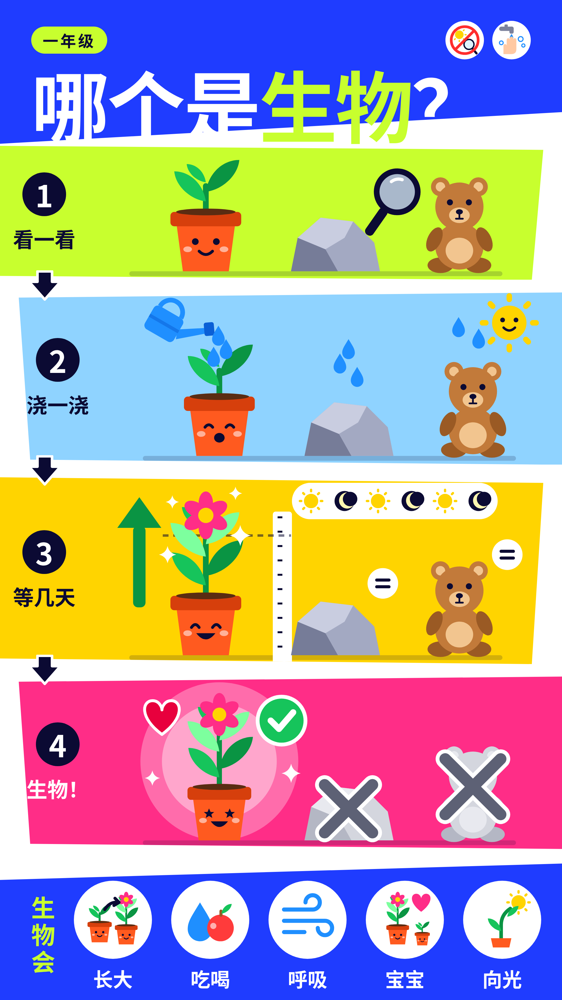
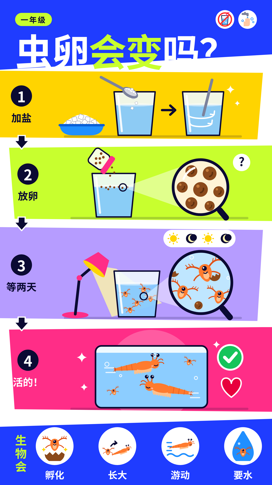
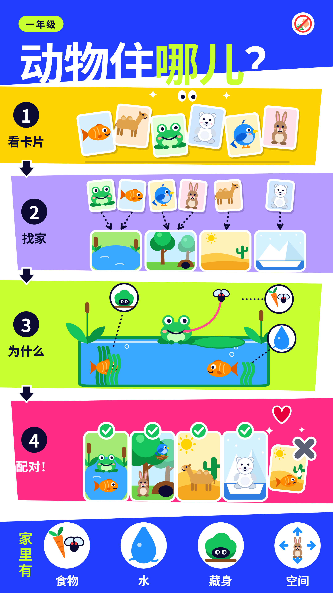

# MyTechWorkShop 青少年科技工坊

青少年 STEM 教育研究与科学探究活动海报集

## 海报

### 全球青少年 STEM 教育研究

[下载 PDF](posters/research/research_poster.pdf)

---

### 一年级科学探究

#### 哪个是生物？

[下载 PDF](posters/science-inquiry/grade1/g1-c1-guided-living-nonliving.pdf)

#### 虫卵会变吗？

[下载 PDF](posters/science-inquiry/grade1/g1-c1-inquiry-brine-shrimp.pdf)

#### 动物住哪儿？

[下载 PDF](posters/science-inquiry/grade1/g1-c2-guided-animal-habitats.pdf)
